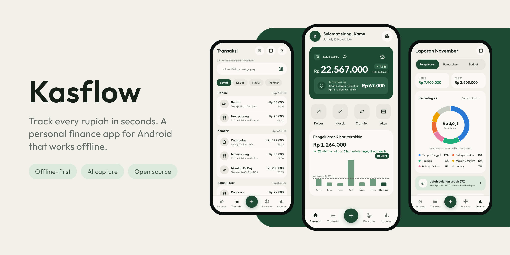
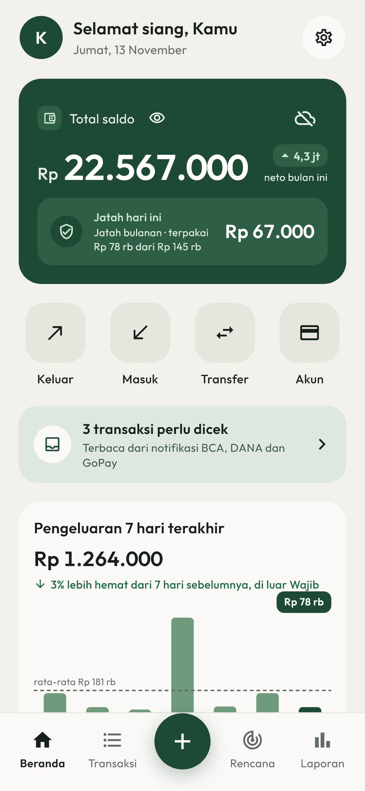
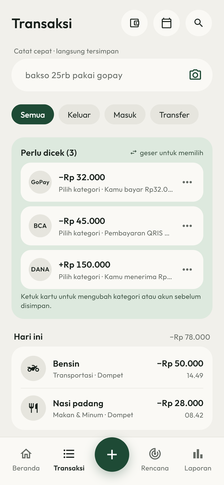
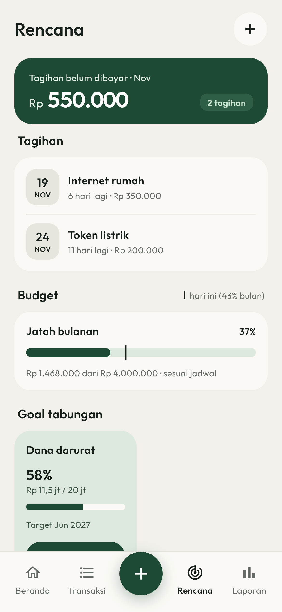
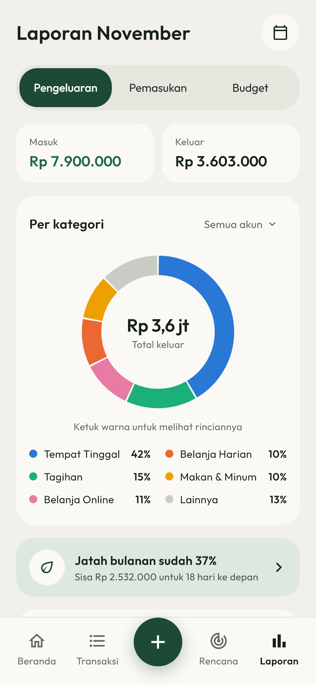
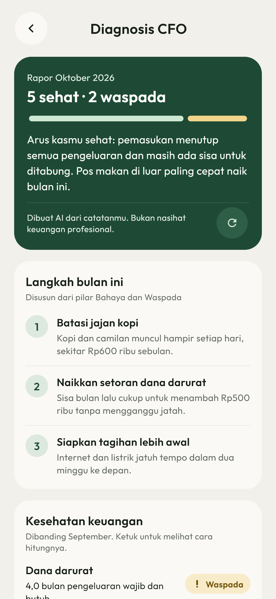
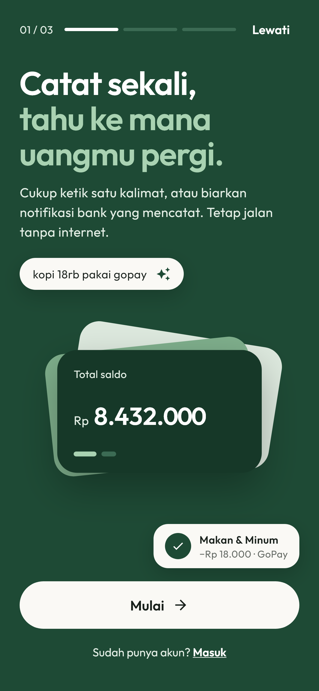

<div align="center">

<picture>
  <source media="(prefers-color-scheme: dark)" srcset="docs/readme/hero-dark.png">
  <source media="(prefers-color-scheme: light)" srcset="docs/readme/hero-light.png">
  
</picture>

<a href="LICENSE"></a>
<a href="https://github.com/zzayyan/kasflow/actions/workflows/checks.yml"></a>


</div>

## Why Kasflow

Most money apps only work if you keep feeding them, and every extra tap is a reason to stop.
Kasflow keeps recording down to a few seconds: type one sentence, snap a receipt, or let your bank's
notification do it. Then it shows where the money went and whether the month is on track.

- **Offline-first.** Your data lives in SQLite on the phone and syncs to your own Supabase project
  through PowerSync. Recording and reading never wait for a connection.
- **AI proposes, you confirm.** Parsed transactions and advice stay editable and never overwrite
  your data silently.
- **Built for Indonesia.** Rupiah, Indonesian UI, and Indonesian bank and e-wallet notifications.

## Features

**Capture**
- Quick input: type `kopi 18rb pakai gopay` and get the amount, category, and account filled in.
- Bank and e-wallet notifications (BCA, GoPay, DANA, and more) become transactions waiting for a
  tap. Names, account numbers, and emails are redacted on the phone before any text reaches the AI.
- Scan a receipt photo into a transaction with its line items.
- Home-screen widget with today's allowance, and an app shortcut straight to quick input.

**Organize**
- Accounts for cash, banks, e-wallets, paylater, credit cards, savings, investments, and loans.
- Categories with a need level (must, need, want), plus labels.
- Bills with reminders, budgets per category, and savings goals.

**Understand**
- Monthly reports for spending, income, and budgets, with a per-category breakdown.
- Diagnosis CFO: a health check of your finances scored only on the months and accounts you
  recorded, with three concrete steps for this month.
- Today's allowance on the home screen: what you can still spend today and stay on budget.

**Everyday comfort**
- Light and dark themes, a fingerprint lock, and a hide-balance switch for public places.
- Optional haptics, and Android's "remove animations" setting is honored.
- Export every transaction as CSV.

## Screenshots

<table>
  <tr>
    <td></td>
    <td></td>
    <td></td>
  </tr>
  <tr>
    <td align="center">Home</td>
    <td align="center">Transactions</td>
    <td align="center">Bills, budgets, goals</td>
  </tr>
  <tr>
    <td></td>
    <td></td>
    <td></td>
  </tr>
  <tr>
    <td align="center">Report</td>
    <td align="center">Diagnosis CFO</td>
    <td align="center">Intro</td>
  </tr>
</table>

The screenshots show made-up data. `screenshots/readme_test.dart` renders them, light and dark:
`flutter test screenshots --update-goldens`.

## Tech stack

- [Flutter](https://flutter.dev) app, Android only
- [PowerSync](https://www.powersync.com) for the on-device SQLite database and sync
- [Supabase](https://supabase.com) for auth, Postgres with row-level security, and Edge Functions
- [Gemini](https://ai.google.dev) behind the Edge Functions for quick input, notifications,
  receipts, and Diagnosis CFO

## Getting started

Kasflow runs on your own backend: a free Supabase project and a free PowerSync instance.

1. Install Flutter and connect an Android phone with USB debugging (`flutter devices` should list it).
2. Connect the backend: run `./scripts/setup-backend.sh` in Git Bash. It walks through Supabase and PowerSync and writes `.env` (template: `.env.example`).
3. Run the app: `flutter run --dart-define-from-file=.env`

Debug builds are JIT-compiled and stutter (a frame can take 600-800 ms), so judge animations and
daily use on a release build:

```sh
flutter build apk --release --split-per-abi --dart-define-from-file=.env
adb install -r build/app/outputs/flutter-apk/app-arm64-v8a-release.apk
```

The release build is signed with the debug key, so it installs over a debug build and keeps the data.

### AI features (optional)

Quick input, notification capture, receipt scans, and Diagnosis CFO call the Edge Functions in
`supabase/functions/`. Recording by hand works without them. To turn them on, set a Gemini API key
as a secret and deploy the functions:

```sh
npx supabase login
npx supabase secrets set GEMINI_API_KEY=<your key> --remote=<ref>
npx supabase functions deploy --remote=<ref>
```

`<ref>` is the subdomain of `SUPABASE_URL` in `.env`.

### Google sign-in (optional)

"Lanjut dengan Google" appears only when `GOOGLE_WEB_CLIENT_ID` is set in `.env`. Setup is outside the repo:

1. Google Cloud Console: create a **Web** OAuth client (its id goes in `.env`) and an **Android** client with package `com.cashflowapp.cashflow_app` and the SHA-1 of the debug keystore (`keytool -list -v -keystore ~/.android/debug.keystore -alias androiddebugkey -storepass android`). Release builds use the same key, so one Android client covers both; another machine has another SHA-1.
2. Supabase Dashboard, Authentication, Providers, Google: enable it with the Web client id and secret. Turn on "Skip nonce check" if sign-in fails with a nonce error. Keep automatic identity linking on, so a Google account with the same verified email as an email account resolves to the same user.

## Project layout

- `lib/` app code: `db.dart` (PowerSync + Supabase connector), `schema.dart` (on-device tables), `money.dart` (amount parsing), `theme.dart` (design tokens), `ui.dart` (shared widgets), `screens/` (one file per screen)
- `supabase/migrations/` database schema, RLS policies, signup trigger
- `supabase/functions/` Edge Functions that call Gemini
- `powersync/sync-config.yaml` which rows each user downloads
- `screenshots/` renders the README images from made-up data

## Checks

- `flutter test`
- `cd supabase/tests && npm install && npm test` runs the migration against PGlite and checks constraints and RLS
- GitHub Actions runs both on every push (`.github/workflows/checks.yml`)
- On the phone, `adb logcat -s flutter` shows the app's log records and uncaught errors, release builds included

## License

[GPL-3.0](LICENSE). The Outfit font is under the [SIL Open Font License](assets/fonts/OFL-Outfit.txt).
